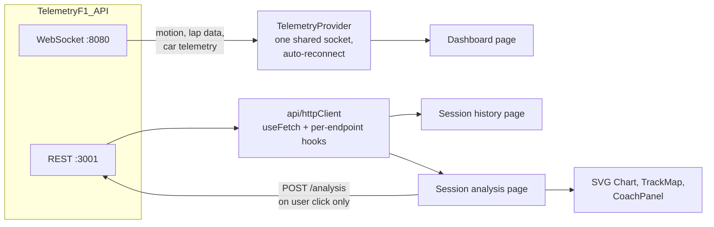

# Telemetry-F1

Frontend for **F1 24** game telemetry: a live dashboard while you drive, a history of recorded sessions, and a two-lap comparison with charts, a track map and an AI coach that explains where time was lost.

It consumes the WebSocket and REST APIs of [TelemetryF1_API](https://github.com/AnaLauraFFerraz/TelemetryF1_API), which must be running. The UI is in Portuguese (pt-BR).

> Screenshots / GIF: _to be added._

## Architecture



`App` wraps everything in an `ErrorBoundary` and a single `TelemetryProvider`. Pages are containers that own hooks and state; components under `src/components/` are presentational and receive data through props.

| Path | Responsibility |
|---|---|
| `src/context/` | WebSocket connection, reconnection, extraction of the player's car from the 22-car arrays |
| `src/api/` | `fetch`-based HTTP client, generic `useFetch`, per-endpoint hooks, manual-trigger coach hook |
| `src/pages/` | Dashboard, session history, session analysis, settings, 404 |
| `src/components/` | Gauges, pedal and steering bars, G-force bubble, tyre grid, lap times, tables, `Chart`, `TrackMap`, `CoachPanel` |
| `src/types/` | REST and WebSocket types, mirrored by hand from the API |
| `src/styles/` | Design tokens and global styles (single dark theme) |

## Features

- **Live dashboard** (`/`): speed, gear and RPM with shift lights, throttle and brake bars, steering, G-force bubble, tyre temperatures and pressures, current/last/best lap times with the current sector, and connection status.
- **Session history** (`/sessions`): recorded sessions with date, duration, lap count and best lap. Rows are keyboard-accessible.
- **Session analysis** (`/sessions/:id`): the most recent lap compared against another lap of your choice (the best valid lap is pre-selected when it is not the most recent one):
  - cumulative time delta, speed, throttle/brake and tyre temperature charts over lap distance, with a hover crosshair and tooltip;
  - a 2D track map overlaying the two laps' trajectories;
  - an **AI coach panel**: on request, shows the coach's analysis and its top three time-loss opportunities as chips; selecting one highlights that corner on the delta, speed and pedal charts.
- **Settings** (`/settings`): WebSocket state and whether packets arrived recently.
- **Resilience**: automatic WebSocket reconnection with exponential backoff, and a top-level error boundary.

## Getting started

Requirements: Node.js ≥ 22.6 and the [API](https://github.com/AnaLauraFFerraz/TelemetryF1_API) running (with the game, or with a recording and its replayer).

```bash
npm install
cp .env.example .env    # VITE_WS_URL, VITE_HTTP_API_URL
npm run dev
```

Open `http://localhost:5173`. Use `localhost` rather than `127.0.0.1`: the dev server may bind only to the IPv6 loopback.

## Scripts and tests

```bash
npm run build     # type-check and production build
npm run lint      # ESLint
npm test          # 16 tests, Node's built-in runner with --experimental-strip-types
```

The tests cover pure functions: chart path building and nearest-point search, cumulative delta interpolation, track map projection and the coach opportunity ranking. There are no component or hook tests yet.

## Technical decisions and trade-offs

**No state, chart or data-fetching libraries.** State is React Context plus hooks, data fetching is a small `useFetch` with a discriminated `loading / error / success` state, and the charts are a custom SVG component. With three read endpoints and one action, a library would add more than it saves, and the chart engine stays small and fully controllable (diverging axes, markers, highlight ranges).

**One telemetry context.** All live data lives in a single context, so every consumer re-renders on every packet. That is acceptable at the current size; splitting the context per packet type is the next step if it ever causes jank.

**Unstable connections.** `TelemetryProvider` reconnects with exponential backoff, `min(1000 · 2^attempt, 15000)` ms, retried indefinitely and reset on a successful connection. Liveness is checked server-side (WebSocket ping/pong). On the client, the settings page only shows whether a packet arrived in the last 5 seconds.

**The coach runs on demand.** A new analysis is a paid API call when the server has no cached result, so it only happens when the user clicks. Results for a lap pair that is no longer selected are treated as stale and hidden, derived during render rather than reset with an effect.

**CSS Modules with design tokens.** Each component has its own module; colours come only from `tokens.css` custom properties, including those passed from TypeScript.

**Hand-mirrored API types.** The API owns the contract and this repo keeps a copy in `src/types/`. With two small repos that is simpler than a shared package, at the cost of keeping them in sync manually.

## Known limitations

- There is no client-side heartbeat, and the `disconnected` state is never reached (reconnection retries forever).
- The chart crosshair and tooltip are mouse-only.
- The primary lap is always the most recent one; only the comparison lap is selectable.
- The dashboard's tyre colours use a 70–110 °C window, while the API's analysis uses 85–105 °C.
- A missing `VITE_*` variable throws before React renders, which results in a blank page.

## Next steps

Planned with Spec Driven Development, mostly on the API side:

1. Real-time replay of recorded sessions (prerequisite for the demo).
2. Stable API error codes, with this app deciding by code instead of matching message strings.
3. **Public demo** running from a recorded session, and **CI** (lint, tests, build) on GitHub Actions.
