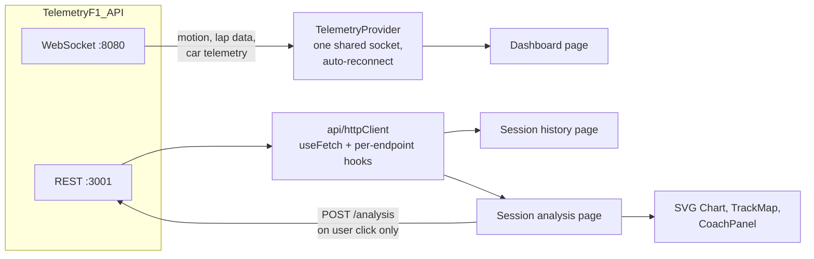

# Telemetry-F1

[](https://github.com/AnaLauraFFerraz/Telemetry-F1/actions/workflows/ci.yml)

Frontend for **F1 24** game telemetry: a live dashboard while you drive, a history of recorded sessions, and a two-lap comparison with charts, a track map and an AI coach that explains where time was lost.

It consumes the WebSocket and REST APIs of [TelemetryF1_API](https://github.com/AnaLauraFFerraz/TelemetryF1_API), which must be running. The UI is in Portuguese (pt-BR).

> Screenshots / GIF: _to be added._

## Architecture



`App` wraps everything in an `ErrorBoundary` and a single `TelemetryProvider`. Pages are containers that own hooks and state; components under `src/components/` are presentational and receive data through props.

| Path | Responsibility |
|---|---|
| `src/context/` | WebSocket connection, reconnection, extraction of the player's car from the 22-car arrays |
| `src/api/` | `fetch`-based HTTP client, generic `useFetch`, per-endpoint hooks, manual-trigger coach hook |
| `src/pages/` | Dashboard, session history, session analysis, settings, 404 |
| `src/components/` | Gauges, pedal and steering bars, G-force bubble, tyre grid, lap times, tables, `Chart`, `TrackMap`, `CoachPanel` |
| `src/types/` | REST and WebSocket types, mirrored by hand from the API |
| `src/styles/` | Design tokens and global styles (single dark theme) |

## Features

- **Live dashboard** (`/`): speed, gear and RPM with shift lights, throttle and brake bars, steering, G-force bubble, tyre temperatures and pressures, current/last/best lap times with the current sector, and connection status.
- **Session history** (`/sessions`): recorded sessions with date, duration, lap count and best lap. Rows are keyboard-accessible.
- **Session analysis** (`/sessions/:id`): the most recent lap compared against another lap of your choice (the best valid lap is pre-selected when it is not the most recent one):
  - cumulative time delta, speed, throttle/brake and tyre temperature charts over lap distance, with a hover crosshair and tooltip;
  - a 2D track map overlaying the two laps' trajectories;
  - an **AI coach panel**: on request, shows the coach's analysis and its top three time-loss opportunities as chips; selecting one highlights that corner on the delta, speed and pedal charts.
- **Settings** (`/settings`): WebSocket state and whether packets arrived recently.
- **Resilience**: automatic WebSocket reconnection with exponential backoff, and a top-level error boundary.

## Getting started

Requirements: Node.js ≥ 22.17 (major pinned in `.nvmrc`) and the [API](https://github.com/AnaLauraFFerraz/TelemetryF1_API) running (with the game, or with a recording and its replayer).

```bash
npm install
cp .env.example .env    # VITE_WS_URL, VITE_HTTP_API_URL
npm run dev
```

Open `http://localhost:5173`. Use `localhost` rather than `127.0.0.1`: the dev server may bind only to the IPv6 loopback.

## Scripts and tests

```bash
npm run build     # type-check and production build
npm run lint      # ESLint
npm run typecheck  # type-check only (src/, tools/ and vite.config.ts), no bundle
npm test          # Node's built-in runner with --experimental-strip-types; finds every src/**/*.test.ts
```

The tests cover pure functions: chart path building and nearest-point search, cumulative delta interpolation, track map projection and the coach opportunity ranking. There are no component or hook tests yet.

`npm test` first runs a guard that fails when no test file is found, because `node --test` exits with 0 on an empty glob. The guard also fails when the `test` script in `package.json` does not contain the glob in double quotes, because with single quotes cmd runs zero tests and exits with 0.

## CI and branch protection

Every pull request to `main` and every push to `main` runs [`.github/workflows/ci.yml`](.github/workflows/ci.yml) on `ubuntu-24.04`, as four independent checks. Each one runs a single `package.json` script on a clean checkout, with no secrets, no `.env` and no API running:

| Check | Script |
|---|---|
| `typecheck` | `npm run typecheck` |
| `lint` | `npm run lint` |
| `test` | `npm test` |
| `build` | `npm run build` |

A type error fails both `typecheck` and `build`, because `build` still runs `tsc -b` before `vite build`. The Node version is read from `.nvmrc`, and npm's download cache is keyed on `package-lock.json`.

**The check names are a contract.** The branch ruleset matches the job names, and the badge points at the file name. Renaming a job, or adding another workflow with a job of the same name, requires updating the required checks in the ruleset in the same change; otherwise every pull request waits forever for a check that never reports. Renaming `ci.yml` requires updating the badge.

### Protecting `main`

The ruleset is created by hand by the repository owner; nothing in the code applies it.

1. Settings → Rules → Rulesets → New ruleset → New branch ruleset.
2. Enforcement status: **Active**. Leave the bypass list empty.
3. Target branches: the default branch (`main`).
4. Enable **Restrict deletions**, **Require linear history** and **Block force pushes**.
5. Enable **Require a pull request before merging** with 0 required approvals.
6. Enable **Require status checks to pass**, tick **Require branches to be up to date before merging**, and add the four checks `typecheck`, `lint`, `test` and `build` (source: GitHub Actions).
7. Click **Create**.
8. Settings → General → Pull Requests: keep only **Allow rebase merging** and enable **Automatically delete head branches**.

### Last resort if GitHub Actions is down

Wait first. Only if the outage continues, set the ruleset's **Enforcement status** to **Disabled**, merge, set it back to **Active** right away, and record the reason in the pull request.

## Technical decisions and trade-offs

**No state, chart or data-fetching libraries.** State is React Context plus hooks, data fetching is a small `useFetch` with a discriminated `loading / error / success` state, and the charts are a custom SVG component. With three read endpoints and one action, a library would add more than it saves, and the chart engine stays small and fully controllable (diverging axes, markers, highlight ranges).

**One telemetry context.** All live data lives in a single context, so every consumer re-renders on every packet. That is acceptable at the current size; splitting the context per packet type is the next step if it ever causes jank.

**Unstable connections.** `TelemetryProvider` reconnects with exponential backoff, `min(1000 · 2^attempt, 15000)` ms, retried indefinitely and reset on a successful connection. Liveness is checked server-side (WebSocket ping/pong). On the client, the settings page only shows whether a packet arrived in the last 5 seconds.

**The coach runs on demand.** A new analysis is a paid API call when the server has no cached result, so it only happens when the user clicks. Results for a lap pair that is no longer selected are treated as stale and hidden, derived during render rather than reset with an effect.

**CSS Modules with design tokens.** Each component has its own module; colours come only from `tokens.css` custom properties, including those passed from TypeScript.

**Hand-mirrored API types.** The API owns the contract and this repo keeps a copy in `src/types/`. With two small repos that is simpler than a shared package, at the cost of keeping them in sync manually.

## Known limitations

- There is no client-side heartbeat, and the `disconnected` state is never reached (reconnection retries forever).
- The chart crosshair and tooltip are mouse-only.
- The primary lap is always the most recent one; only the comparison lap is selectable.
- The dashboard's tyre colours use a 70–110 °C window, while the API's analysis uses 85–105 °C.
- A missing `VITE_*` variable throws before React renders, which results in a blank page.
- Without the backend's `ANTHROPIC_API_KEY`, the coach panel shows the 503 message.
- The glob of the `test` script uses escaped double quotes in `package.json`. With single quotes, cmd (npm's default shell on Windows) runs zero tests and exits with 0. The `pretest` guard fails when the script lacks the double-quoted glob; the Linux CI is a second line of defence, because sh treats single quotes as quotes and the tests run.

## Next steps

Planned with Spec Driven Development, mostly on the API side:

1. Real-time replay of recorded sessions (prerequisite for the demo).
2. Stable API error codes, with this app deciding by code instead of matching message strings.
3. Tyre temperature windows served by the API and consumed here, so the dashboard and the analysis use the same ranges (pending a check on whether the ideal window depends on the compound).
4. **Public demo** running from a recorded session.
